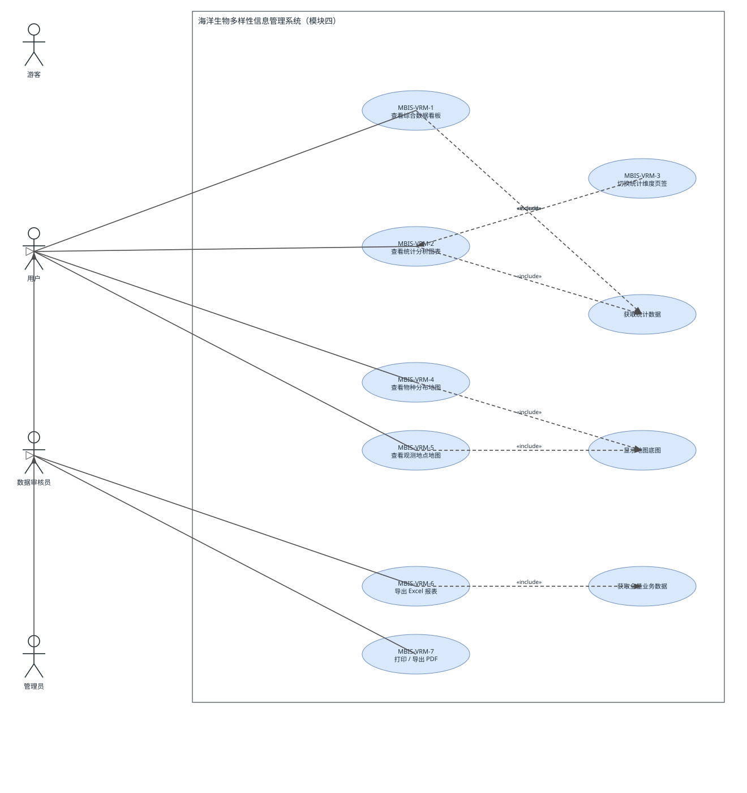
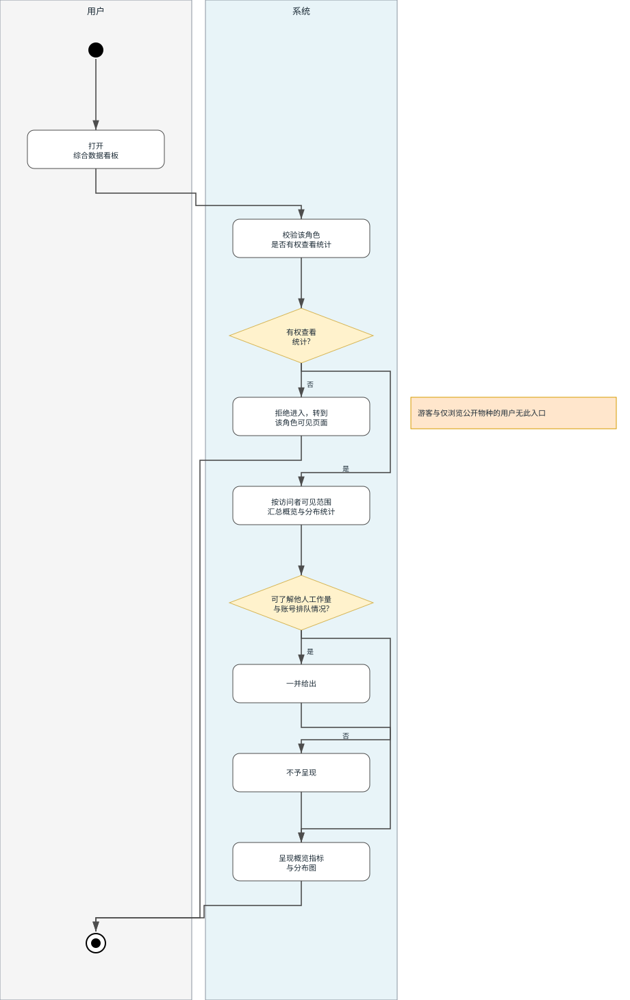
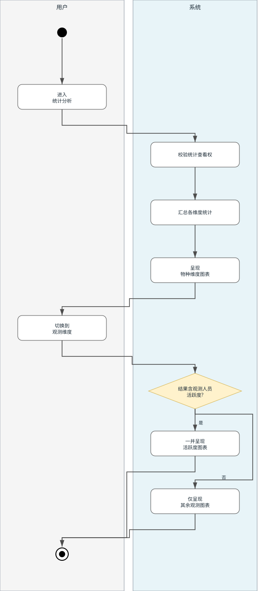
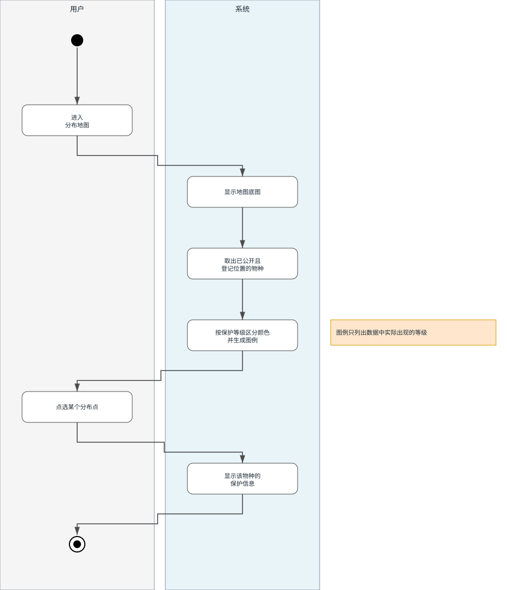
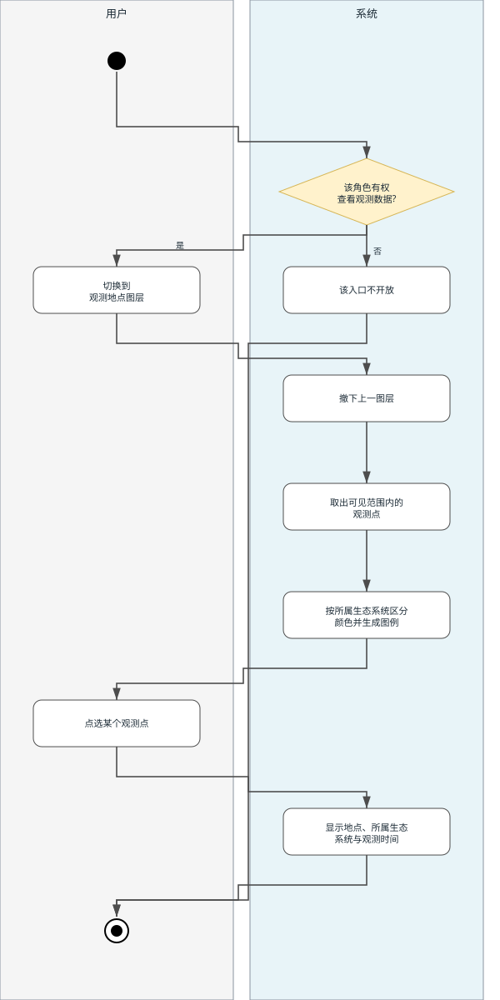
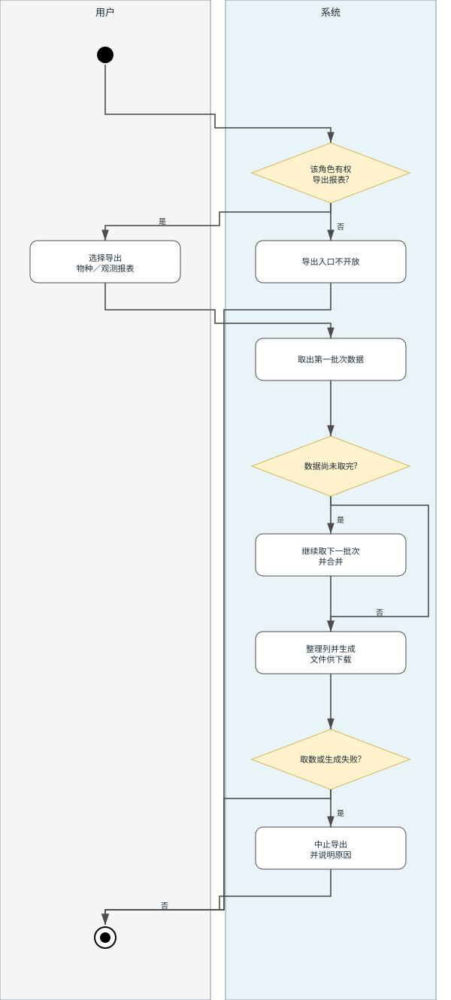
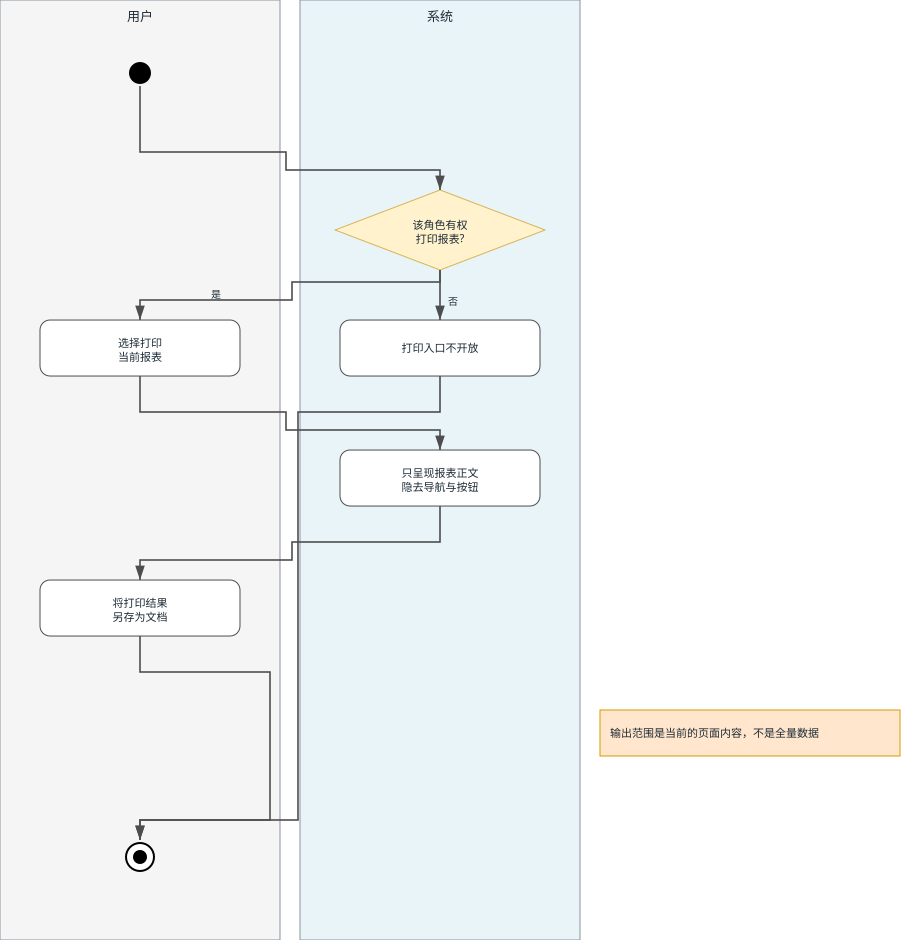

# 《软件构造与体系结构实验》报告

## 需求分析文档

|          |                  |
| :------- | :--------------- |
| 学生姓名 | 陈伟生           |
| 电话     | 13622253918      |
| 学　　号 | 202411701404     |
| 学　　院 | 数学与计算机学院 |
| 专　　业 | 软件工程         |
| 班　　级 | 软件1244         |
| 指导老师 | 岳川             |

**项目成员（同一组本表须一致）**

| 排序 | 姓名   | 学号         | 班级     | 负责内容                  |
| :--- | :----- | :----------- | :------- | :------------------------ |
| 1    | 李煜轩 | 202411701416 | 软件1244 | 模块五：智能 服务         |
| 2    | 卢军原 | 202411701419 | 软件1244 | 模块二：物种 信息         |
| 3    | 陈伟生 | 202411701404 | 软件1244 | 模块四：数据 可视化与报表 |
| 4    | 李继浩 | 202411701413 | 软件1244 | 模块一：用户 与权限       |
| 5    | 布承铿 | 202411701402 | 软件1244 | 模块三：生态 系统与观测   |

# 1 系统缩写表

本表列出全文使用的缩写与术语，见表1-1。

<b>表1-1 缩写、术语表</b>

| 缩写、术语 | 解 释                                                            |
| :--------- | :--------------------------------------------------------------- |
| MBIS       | 海洋生物多样性信息管理系统的简称                                 |
| 游客       | 尚未注册的状态：只能到达登录与注册界面，模块四的七个用例对其全部不可达   |
| 用户       | 注册并经管理员审核通过后的普通账号；按授权范围再分两档（见表2-3）        |
| 数据审核员 | 由管理员赋予用户的权限，可登录与维护物种、观测数据并导出报表             |
| 管理员     | 由管理员赋予用户的权限，在模块四内具备数据审核员的全部能力，并负责审核注册与分配角色 |
| UC         | 用例（Use Case）                                                 |
| SRS        | 需求规范说明书                                                   |
| NFR        | 非功能性需求                                                     |
| UM         | MBIS 的用户与权限管理模块                                        |
| SIM        | MBIS 的物种信息管理模块                                          |
| EOM        | MBIS 的生态系统与观测记录管理模块                                |
| VRM        | MBIS 的数据可视化与报表模块（本文档对象）                        |
| AIM        | MBIS 的智能服务模块                                              |
| RBAC       | 基于角色的访问控制；本系统的角色权限由管理员授予或回收                   |
| 公开情况   | 每条物种记录是否允许对外公开的标记，统计与地图据此限定可见范围           |
| 零号批次   | 分批次取数的约定：第一批的批次编号从零起算，见规则 f-9           |

---

# 2 核心功能需求（模块四 数据可视化与报表）

## 2.1 模块说明与使用者角色

用例是关于用户和系统之间相互作用的文本性描述，从外部角度描述系统行为，表达系统应当做什么。
本章用用例规约描述模块四的需求，作为下一阶段系统设计的基础，同时也是测试用例的重要依据。

模块四的特殊性在于它**不新增业务数据**，只对模块二（物种）、模块三（生态系统与观测记录）、
模块一（用户）已有的数据做只读的汇总呈现。因此它的需求重心不在写操作的正确性，而在两条：
**一次访问获得全貌**，以及**统计口径不得越过数据可见边界**。
各维度统计在同一次访问中一并给出，不逐项反复索取（见规则 f-10）。

模块四由三个功能界面、两类报表出口构成，其界面构成见表2-1，与相邻模块的数据关系见表2-2。

<b>表2-1 模块四界面构成</b>

| 功能界面       | 呈现内容                                              | 数据来自哪些业务对象                       |
| :------------- | :---------------------------------------------------- | :----------------------------------------- |
| 综合数据看板   | 6 张概览指标卡 + 6 张分布图（一次访问取全）           | 物种、生态系统、观测记录、使用者账号       |
| 统计分析与报表 | 「物种统计」4 图、「观测统计」2~3 图；3 个报表出口    | 物种、生态系统、观测记录                   |
| 空间分布地图   | 物种分布图层、观测地点图层（二选一）+ 图例 + 信息展示 | 物种（含分布位置）、观测记录（含发生地点） |

模块四只依赖一项外部内容：公共地图底图服务。模块四不使用智能服务模块的能力。

<b>表2-2 模块四与相邻模块的数据关系</b>

| 模块                          | 代号 | 与模块四的关系                                     |
| :---------------------------- | :--- | :------------------------------------------------- |
| 模块一 用户与权限管理         | UM   | 提供角色与账号计数，作为看板概览项                 |
| 模块二 物种信息管理           | SIM  | 提供物种总量、门类／保护等级／濒危度分布、分布位置 |
| 模块三 生态系统与观测记录管理 | EOM  | 提供生态系统构成、观测次数、逐月趋势、观测地点     |
| 模块四 数据可视化与报表       | VRM  | 本文档对象                                         |
| 模块五 智能服务               | AIM  | 与模块四无数据依赖，互不调用                       |

系统角色分为**游客、用户、数据审核员、管理员**四种（Actor）；「系统」本身在用例图上只作为边界，不画成参与者。
角色的获得途径是：游客注册并提交申请 → 管理员审核通过后成为用户 → 管理员可再把该用户提升为数据审核员或管理员，
且系统须至少保留一名在岗管理员。就模块四而言，各角色可执行的用例见表2-3；其中普通用户按授权范围再分两档，
一档可浏览概览与统计，另一档只能查看已公开的物种信息。

<b>表2-3 角色与模块四用例的对应关系</b>

| 角色 | 释义 | MBIS-VRM-1 看板 | MBIS-VRM-2 统计图表 | MBIS-VRM-3 切页签 | MBIS-VRM-4 物种地图 | MBIS-VRM-5 观测地图 | MBIS-VRM-6 Excel | MBIS-VRM-7 PDF |
| :--- | :--- | :--- | :--- | :--- | :--- | :--- | :--- | :--- |
| 游客 | 未注册，只能到达登录与注册界面 | × | × | × | × | × | × | × |
| 用户 · 仅浏览公开物种 | 只能查看已公开的物种信息 | × | × | × | √ | × | × | × |
| 用户 · 可看统计 | 可浏览概览、统计与两类分布图层 | √ | √ | √ | √ | √ | × | × |
| 数据审核员 | 物种与观测数据的登记者与维护者 | √ | √ | √ | √ | √ | √ | √ |
| 管理员 | 数据审核员的全部能力，另含审核注册申请与分配角色 | √ | √ | √ | √ | √ | √ | √ |

表2-3 中管理员与数据审核员在模块四的权限完全相同（其余差异项属其它模块），因此用例图用泛化链
「管理员 ⊳ 数据审核员 ⊳ 用户」表达继承：数据审核员只额外关联两个报表用例，管理员不再单独连线。
游客在图上是不连任何用例的参与者，用以表达"模块四对游客全部不可达"这一需求。
各角色与用例的关联关系如图2-1 所示。

## 2.2 模块四用例图

图2-1 为模块四的用例图，画出系统角色、系统边界与核心用例。
其中实线为角色与用例的关联，虚线箭头为 `«include»`／`«extend»` 依赖，空心三角为角色泛化。
「系统」不画成参与者——外围的矩形框就是系统的边界，框内即本模块要交付的功能；
活动图里作为分区的「系统」指的是这一边界内的职责，两处的含义一致。
三个被多个用例共享的子功能（获取统计数据、显示地图底图、获取全量业务数据）显式画出，
用以固化「同一次进入界面只取一次统计数」这一约束（见规则 f-10）。

<b>图2-1 模块四用例图</b>

图2-1 中「切换统计维度页签」以 `«extend»` 指向「查看统计分析图表」，表示页签切换不是独立入口，
只在图表已呈现时才发生；两个报表出口共用「获取全量业务数据」这一子功能，说明两者的取数口径一致。

## 2.3 用例清单

模块四共七个功能点用例，其编号、涉及角色、优先级、规约小节与活动图见表2-4。

<b>表2-4 用例清单与优先级</b>

| 用例ID     | 用例名称         | 角色                               | 优先级 | 规约小节 | 活动图      |
| :--------- | :--------------- | :--------------------------------- | :----- | :------- | :---------- |
| MBIS-VRM-1 | 查看综合数据看板 | 用户、数据审核员、管理员         | 高     | 2.4      | 图2-2       |
| MBIS-VRM-2 | 查看统计分析图表 | 用户、数据审核员、管理员         | 高     | 2.5      | 图2-3       |
| MBIS-VRM-3 | 切换统计维度页签 | 用户、数据审核员、管理员         | 中     | 2.6      | 归并入图2-3 |
| MBIS-VRM-4 | 查看物种分布地图 | 用户、数据审核员、管理员 | 高     | 2.7      | 图2-4       |
| MBIS-VRM-5 | 查看观测地点地图 | 用户、数据审核员、管理员         | 中     | 2.8      | 图2-5       |
| MBIS-VRM-6 | 导出 Excel 报表  | 数据审核员、管理员                  | 中     | 2.9      | 图2-6       |
| MBIS-VRM-7 | 打印 / 导出 PDF  | 数据审核员、管理员                  | 低     | 2.10     | 图2-7       |

表2-4 中 MBIS-VRM-3 不单列活动图：它是 VRM-2 内部的一个维度切换分支，单独绘制只会得到两个节点的图，
反而割裂事件流；该分支在图2-3 中以显式判定节点呈现。

## 2.4 MBIS-VRM-1 查看综合数据看板

本功能点的用例规约见表2-5，输出内容与角色门槛见表2-6，事件流的活动图见图2-2。

<b>表2-5 MBIS-VRM-1 用例规约</b>

| 用例名称：             | 查看综合数据看板                                                                                                                                                                                                                                                                                                                                                                                                                                                                                                                                        |
| :--------------------- | :------------------------------------------------------------------------------------------------------------------------------------------------------------------------------------------------------------------------------------------------------------------------------------------------------------------------------------------------------------------------------------------------------------------------------------------------------------------------------------------------------------------------------------------------------ |
| **用例ID：**     | MBIS-VRM-1                                                                                                                                                                                                                                                                                                                                                                                                                                                                                                                                              |
| **角色：**       | 用户、数据审核员、管理员                                                                                                                                                                                                                                                                                                                                                                                                                                                                                                                              |
| **用例说明：**   | 角色进入综合数据看板，一次获得系统概览与多维分布。                                                                                                                                                                                                                                                                                                                                                                                                                                                                                                      |
| **前置条件：**   | 角色已登录 MBIS 且登录状态有效；使用者不属于仅浏览公开物种的一档。                                                                                                                                                                                                                                                                                                                                                                                                                                                                                                       |
| **基本事件流：** | 1. 用户、数据审核员或管理员 从导航进入综合数据看板。2. 系统确认该角色是否具备统计查看权。3. 系统发起一次统计取数，界面提示「统计中，请稍候…」。4. 系统按访问者的可见范围统计：可见物种总数、观测记录总数、本月观测数、近三十日观测数、生态系统数。5. 若角色为 数据审核员或管理员，系统一并给出数据审核员数、系统用户总数、待审核用户数。6. 系统一并给出各维度的分布统计：门类、保护等级、濒危度、生态系统、逐月。7. 若角色为 数据审核员或管理员，系统一并给出观测人员活跃度（真实姓名与提交条数，取前十项）。8. 界面呈现概览指标与分布图，用例结束。 |
| **其它事件流：** | 第 5、7 步，使用者为普通用户：结果中不含他人工作量与账号排队情况，界面相应不呈现「数据审核员」「待审核用户」两类概览与「观测人员活跃度」一张图（普通用户能看看板，但看不到他人工作量与排队数）。第 2 步，使用者为游客或仅浏览公开物种的用户：该入口不开放，转到该角色可见的界面；即使绕开入口直接向系统索取，也被拒绝。第 3 步，使用者点击「刷新」：重新执行第 3~8 步，每次点击只取一次数。第 6 步，某维度没有数据：该图呈现为空，不得显示虚构刻度或伪造类别。                                                                                                                       |
| **异常事件流：** | 第 3 步，登录状态已失效：系统要求重新登录，并在登录后返回本界面。第 4~7 步，统计取数失败：界面给出中文失败原因，**保留上一次成功结果**，不得把失败显示成「全部为 0」。                                                                                                                                                                                                                                                                                                                                                                            |
| **后置条件：**   | 系统状态不变（本用例只读）；使用者看到与其角色相称的概览与分布。                                                                                                                                                                                                                                                                                                                                                                                                                                                                                        |

<b>表2-6 MBIS-VRM-1 输出内容与角色门槛</b>

| 输出内容                       | 角色门槛                           |
| :----------------------------- | :--------------------------------- |
| 物种总数                       | 全角色，数值按公开情况限定可见范围 |
| 观测记录总数／本月观测数       | 全角色                             |
| 近三十日观测数                 | 全角色                             |
| 生态系统数                     | 全角色                             |
| 数据审核员数／系统用户总数       | **仅** 数据审核员与管理员     |
| 待审核用户数                   | **仅** 数据审核员与管理员     |
| 门类／保护等级／濒危度分布     | 全角色，按可见范围统计             |
| 各生态系统观测次数与发现物种数 | 全角色，物种数按可见范围统计       |
| 逐月观测次数                   | 全角色                             |
| 观测人员活跃度前十项           | **仅** 数据审核员与管理员     |

表2-6 的七个维度在一次访问中一并给出，实测本机响应约 60 ms；表中「仅数据审核员与管理员」的四项
是模块四唯一的按角色裁剪点，并且由系统侧执行而非仅靠界面隐藏——只靠界面隐藏不构成访问控制。

图2-2 给出表2-5 基本事件流的活动图，两栏分别对应使用者与系统的职责，流程自上而下。

<b>图2-2 MBIS-VRM-1 查看综合数据看板活动图</b>

图2-2 中有两个判定：第一个判定发生在进入界面之前（该角色能否查看统计），第二个判定决定统计结果的取舍
（能否看到他人工作量与账号排队情况）。两者缺一不可：只在前者拦截而不在后者取舍，直接索取仍能拿到超范围内容。
「拒绝进入」分支是无统计查看权者的唯一出口，图右侧备注同时说明直接索取也会被拒绝。

## 2.5 MBIS-VRM-2 查看统计分析图表

本功能点的用例规约见表2-7，事件流的活动图见图2-3。

<b>表2-7 MBIS-VRM-2 查看统计分析图表用例规约</b>

| 用例名称：             | 查看统计分析图表                                                                                                                                                                                                                                                                                                    |
| :--------------------- | :------------------------------------------------------------------------------------------------------------------------------------------------------------------------------------------------------------------------------------------------------------------------------------------------------------------ |
| **用例ID：**     | MBIS-VRM-2                                                                                                                                                                                                                                                                                                          |
| **角色：**       | 用户、数据审核员、管理员                                                                                                                                                                                                                                                                                          |
| **用例说明：**   | 角色在统计分析界面按「物种／观测」两个维度查看多维统计图。                                                                                                                                                                                                                                                          |
| **前置条件：**   | 角色已登录且具备统计查看权。                                                                                                                                                                                                                                                                                        |
| **基本事件流：** | 1. 角色进入统计分析界面。2. 系统确认该角色的统计查看权。3. 系统一次取回全部统计结果。4. 系统按门类、保护等级、濒危度、生态系统、逐月等维度汇总。5. 界面默认呈现「物种统计」：三张占比图（含百分比标签）加一张对比图。6. 界面常驻说明「统计口径为全量数据，不受列表分页影响」。7. 用例结束（图形随界面宽度自适应）。 |
| **其它事件流：** | 第 3 步，角色点击「刷新」：重新执行第 3~5 步。第 5 步，角色切换维度：转入 MBIS-VRM-3，不再次取数，复用同一次结果。第 4 步，物种的某项分类没有填写：该记录归入名为「未填写」的分组，不得被静默丢弃。第 5 步，占比图类别较多：图例置于底部并允许避让重叠；对比图项目多于六项时刻度倾斜。                              |
| **异常事件流：** | 第 3 步，取数失败：界面以中文显示原因，保留原有结果，不得清空成「无数据」。第 3 步，登录状态失效：要求重新登录，并在登录后返回本界面。                                                                                                                                                                              |
| **后置条件：**   | 系统状态不变；使用者看到与角色相符的统计图。                                                                                                                                                                                                                                                                        |

图2-3 给出表2-7 基本事件流的活动图，并把 MBIS-VRM-3 的维度切换作为显式判定分支画在同一条流程内。

<b>图2-3 MBIS-VRM-2 查看统计分析图表活动图（含 MBIS-VRM-3 维度切换分支）</b>

图2-3 的关键约束是两个呈现分支共用同一次取数：判定节点只检查已经取回的结果，不再发起索取，
因此无论维度如何反复切换，一次进入界面的取数次数都保持为 1（见规则 f-10）。

## 2.6 MBIS-VRM-3 切换统计维度页签

本功能点是从 MBIS-VRM-2 派生的扩展用例，其用例规约见表2-8；事件流活动图归并入图2-3，不单独成图。

<b>表2-8 MBIS-VRM-3 切换统计维度页签用例规约</b>

| 用例名称：             | 切换统计维度页签                                                                                                                                                                                  |
| :--------------------- | :------------------------------------------------------------------------------------------------------------------------------------------------------------------------------------------------ |
| **用例ID：**     | MBIS-VRM-3                                                                                                                                                                                        |
| **角色：**       | 用户、数据审核员、管理员                                                                                                                                                                        |
| **用例说明：**   | 角色在「物种统计」与「观测统计」两组图表之间切换。                                                                                                                                                |
| **前置条件：**   | 已处于统计分析界面且 MBIS-VRM-2 的数据已呈现。                                                                                                                                                    |
| **基本事件流：** | 1. 角色点击「物种统计」或「观测统计」。2. 系统切换当前维度。3. 界面呈现对应图形组：物种维度为 4 张图；观测维度为生态系统对比图、逐月趋势图，以及在有活跃度数据时的观测人员活跃度图。4. 用例结束。 |
| **其它事件流：** | 第 3 步，使用者为普通用户：结果中没有活跃度内容，观测维度只呈现 2 张图，活跃度图不出现。第 3 步，使用者为数据审核员或管理员：观测维度呈现 3 张图。第 1 步，重复点击当前维度：无变化，不发起取数。     |
| **异常事件流：** | 无（本用例不取数，失败情形等同 MBIS-VRM-2 的异常事件流）。                                                                                                                                        |
| **后置条件：**   | 系统状态不变；仅呈现内容随维度改变。                                                                                                                                                              |

表2-8 的「其它事件流」即是图2-3 中判定节点的两个取值：呈现 3 图或 2 图，差异完全由系统是否给出
活跃度内容决定，界面不自行推断角色。

## 2.7 MBIS-VRM-4 查看物种分布地图

本功能点的用例规约见表2-9，事件流的活动图见图2-4。

<b>表2-9 MBIS-VRM-4 查看物种分布地图用例规约</b>

| 用例名称：             | 查看物种分布地图                                                                                                                                                                                                                                                                                                                                   |
| :--------------------- | :------------------------------------------------------------------------------------------------------------------------------------------------------------------------------------------------------------------------------------------------------------------------------------------------------------------------------------------------- |
| **用例ID：**     | MBIS-VRM-4                                                                                                                                                                                                                                                                                                                                         |
| **角色：**       | 用户、数据审核员、管理员                                                                                                                                                                                                                                                                                                                 |
| **用例说明：**   | 角色在地图上查看已公开物种的分布位置及其保护信息。                                                                                                                                                                                                                                                                                                 |
| **前置条件：**   | 角色已登录并进入空间分布地图（默认进入本图层）。                                                                                                                                                                                                                                                                                                   |
| **基本事件流：** | 1. 角色进入空间分布地图。2. 系统显示地图底图，默认视野为湛江海域一带。3. 系统取出**已公开且登记了分布位置**的物种（名称、学名、保护等级、濒危度、位置）。4. 系统按保护等级区分标记颜色。5. 系统生成图例，**只列出数据中真实出现的等级**。6. 角色点选某个分布标记。7. 系统显示该物种的名称、学名、保护等级、濒危度与位置。8. 用例结束。 |
| **其它事件流：** | 第 5 步，数据中存在未登记的等级：以一个区分色呈现并把该等级补进图例，不得静默丢弃。第 4、7 步，等级或濒危度为空：显示「未评定」。第 3 步，没有任何可定位数据：图例区显示「当前范围内暂无可定位的数据点」，不得留白。第 8 步，角色切换到观测地点图层：先撤下本图层，见 MBIS-VRM-5。                                                                 |
| **异常事件流：** | 第 2 步，外部底图不可达：底图缺失，但标记、图例与信息展示仍可用（降级可接受）。第 3 步，取数失败：界面以中文说明原因，不得显示伪造的空结果。                                                                                                                                                                                  |
| **后置条件：**   | 系统状态不变；离开本界面时地图占用被释放。                                                                                                                                                                                                                                                                                                         |

图2-4 给出表2-9 基本事件流的活动图。

<b>图2-4 MBIS-VRM-4 查看物种分布地图活动图</b>

图2-4 有两处值得注意：底图属于外部内容，与系统内的物种数据是两条来源；标记内容取自使用者的输入文本，
因此信息展示环节要求按纯文本呈现（见规则 f-8），图例的取舍单独成节点是为了强调它不得预置类别（规则 f-7）。

## 2.8 MBIS-VRM-5 查看观测地点地图

本功能点的用例规约见表2-10，事件流的活动图见图2-5。

<b>表2-10 MBIS-VRM-5 查看观测地点地图用例规约</b>

| 用例名称：             | 查看观测地点地图                                                                                                                                                                                                                                                                                                                                                 |
| :--------------------- | :--------------------------------------------------------------------------------------------------------------------------------------------------------------------------------------------------------------------------------------------------------------------------------------------------------------------------------------------------------------- |
| **用例ID：**     | MBIS-VRM-5                                                                                                                                                                                                                                                                                                                                                       |
| **角色：**       | 用户、数据审核员、管理员                                                                                                                                                                                                                                                                                                                                       |
| **用例说明：**   | 角色在地图上查看观测事件的发生地点及其环境与物种信息。                                                                                                                                                                                                                                                                                                           |
| **前置条件：**   | 角色已登录且具备统计查看权；当前处于空间分布地图。                                                                                                                                                                                                                                                                                                               |
| **基本事件流：** | 1. 角色切换到「观测地点地图」图层。2. 系统撤下上一图层，禁止两种标记混绘。3. 系统取出按访问者可见范围过滤后的观测地点（地点名、所属生态系统、观测时间、发现物种数、位置）。4. 系统按所属生态系统区分标记颜色。5. 系统生成图例（每个出现的生态系统一项）。6. 角色点选某个观测地点标记。7. 系统显示地点名、所属生态系统、观测时间、发现物种数与位置。8. 用例结束。 |
| **其它事件流：** | 第 3 步，观测记录未指定生态系统：归入「未指定」，并给一个有效颜色，不得出现无颜色标记。第 4 步，生态系统种类多于可用颜色数：颜色循环复用，图例仍逐项列全。第 1 步，使用者为游客或仅浏览公开物种的用户：该图层入口不开放，本用例不可达。                                                                                                                                               |
| **异常事件流：** | 第 3 步，取数失败：以中文说明原因并保留上一图层状态，不得用空图层冒充「没有观测地点」。第 3 步，登录状态失效：要求重新登录。                                                                                                                                                                                                                                     |
| **后置条件：**   | 系统状态不变；当前图层为观测地点图层。                                                                                                                                                                                                                                                                                                                           |

图2-5 给出表2-10 基本事件流的活动图，其起点即为权限判定。

<b>图2-5 MBIS-VRM-5 查看观测地点地图活动图</b>

图2-5 与图2-4 的结构差异在于判定节点位于流程最前端：不具备统计查看权时该入口根本不开放，
使用者无法触达取数环节。这一层与表2-3 中该列的两个 × 相互对应。

## 2.9 MBIS-VRM-6 导出 Excel 报表

本功能点的用例规约见表2-11，事件流的活动图见图2-6。

<b>表2-11 MBIS-VRM-6 导出 Excel 报表用例规约</b>

| 用例名称：             | 导出 Excel 报表                                                                                                                                                                                                                                                                                                                                           |
| :--------------------- | :-------------------------------------------------------------------------------------------------------------------------------------------------------------------------------------------------------------------------------------------------------------------------------------------------------------------------------------------------------- |
| **用例ID：**     | MBIS-VRM-6                                                                                                                                                                                                                                                                                                                                                |
| **角色：**       | 数据审核员、管理员                                                                                                                                                                                                                                                                                                                                         |
| **用例说明：**   | 角色把物种或观测记录的全量数据导出为本地报表文件。                                                                                                                                                                                                                                                                                                        |
| **前置条件：**   | 角色已登录且为 数据审核员或管理员。                                                                                                                                                                                                                                                                                                                      |
| **基本事件流：** | 1. 角色选择「导出物种报表」或「导出观测报表」。2. 系统取出第一批次数据。3. 系统依据总量判断是否已取完。4. 若未取完，系统继续取下一批次并合并，直至取满全量。5. 系统整理列与写法：公开情况写作「是／否」，观测的生态系统写成名称，观测时间写成可读格式。6. 角色在本机得到报表文件。7. 用例结束。                                                           |
| **其它事件流：** | 第 1 步，使用者为普通用户（两档皆是）：导出入口不开放，无此出口。第 3 步，总量不超过一个批次：不再继续取数，一次即为全量。第 5 步，物种报表为 12 列（中文名、学名、门、纲、目、科、保护等级、濒危度、分布区域、经度、纬度、是否公开）；观测报表为 10 列（观测时间、生态系统、观测地点、经度、纬度、水温、盐度、水深、天气、备注），带单位的列在表头写明单位。 |
| **异常事件流：** | 第 4 步，某一批次取数失败：**中止整个导出**并以中文说明原因，不得产出缺批次的残缺文件。第 6 步，文件生成失败：说明原因，不得静默降级为残缺或空文件。                                                                                                                                                                                                |
| **后置条件：**   | 系统状态不变；使用者获得覆盖全量数据的报表文件。                                                                                                                                                                                                                                                                                                          |

图2-6 给出表2-11 基本事件流的活动图，其中三处判定分别对应权限、批次取满与失败处理。

<b>图2-6 MBIS-VRM-6 导出 Excel 报表活动图</b>

图2-6 的「继续取下一批次并合并」是导出与列表浏览最本质的区别：浏览只要一个批次，导出必须取满全量，
所以流程里显式画出「数据尚未取完?」判定；「取数或生成失败?」分支选择中止而非继续，是因为缺批次的文件
看起来正常，比直接报错更危险（见规则 f-9）。

## 2.10 MBIS-VRM-7 打印 / 导出 PDF

本功能点的用例规约见表2-12，事件流的活动图见图2-7。

<b>表2-12 MBIS-VRM-7 打印 / 导出 PDF 用例规约</b>

| 用例名称：             | 打印 / 导出 PDF                                                                                                                                        |
| :--------------------- | :----------------------------------------------------------------------------------------------------------------------------------------------------- |
| **用例ID：**     | MBIS-VRM-7                                                                                                                                             |
| **角色：**       | 数据审核员、管理员                                                                                                                                      |
| **用例说明：**   | 角色把当前报表界面呈现的内容经打印另存为文档。                                                                                                         |
| **前置条件：**   | 角色已登录且为 数据审核员或管理员；界面数据已呈现。                                                                                                   |
| **基本事件流：** | 1. 角色选择「打印 / 导出 PDF」。2. 系统只整理报表正文，隐去导航、按钮等非正文内容。3. 角色在使用者的打印界面选择另存为文档。4. 用例结束。              |
| **其它事件流：** | 第 1 步，使用者为普通用户（两档皆是）：该出口不开放。第 2 步，记录条数与页范围提示所在区域也被隐去，导致输出**不含「共 N 条、第 X 页」的范围提示**。 |
| **异常事件流：** | 第 2 步，使用者的环境不允许打印：无输出，可改由其菜单打印。第 2 步，图形以位图方式呈现时：打印支持不足则输出中图形为空白。                             |
| **后置条件：**   | 系统状态不变；使用者获得文档或打印件。                                                                                                                 |
| **备注：**       | **输出范围是当前页面内容**，与 MBIS-VRM-6 的全量口径不同，两者不应被表述为等价。                                               |

图2-7 给出表2-12 基本事件流的活动图。

<b>图2-7 MBIS-VRM-7 打印 / 导出 PDF 活动图</b>

图2-7 中系统一侧只有一个整理动作——把报表正文交给使用者的打印环节，输出成什么文件由使用者决定，
这就是它与图2-6 的口径差异所在：输出范围只到当前页面内容。

---

# 3 非功能性需求

非功能性需求从性能、可扩展性、可用性、安全性、易用性、可维护性六个方面阐述，逐条编号见表3-1。
其中性能项为本机单机实测，未做并发压测；未达成项不做美化。

<b>表3-1 模块四非功能性需求</b>

| 编号    | 类别     | 需求                           | 验收方式 / 实测                                                               |
| :------ | :------- | :----------------------------- | :---------------------------------------------------------------------------- |
| NFR-1-1 | 性能     | 综合看板呈现小于 3 秒          | 实测约 60 ms；各维度统计合并为一次取数                                        |
| NFR-1-2 | 性能     | 统计不得逐项反复取数           | 一次进入界面只发起一次统计取数；汇总一次完成                                  |
| NFR-1-3 | 性能     | 地图数据呈现小于 3 秒          | 实测小于 100 ms；生态维度的观测次数与发现物种数一并取回                       |
| NFR-2-1 | 可扩展性 | 新增统计维度不改需求口径       | 增加维度不影响既有角色门槛与呈现规则                                          |
| NFR-2-2 | 可扩展性 | 配色与图例规则集中定义         | 同一规则只在一处约定，避免多处重复描述                                        |
| NFR-3-1 | 可用性   | 加载态、空数据态、出错态齐备   | 「统计中，请稍候…」、中文失败原因、空数据提示                                |
| NFR-3-2 | 可用性   | 失败不得伪装为「无数据」       | 统计失败显示原因；无可定位点时图例区明示，而非留白                            |
| NFR-3-3 | 可用性   | 外部底图不可达时功能降级       | 断网验证：底图缺失但标记、图例与信息展示可用                                  |
| NFR-3-4 | 可用性   | 统计口径可自证                 | 界面常驻「统计口径为全量数据，不受列表分页影响」                              |
| NFR-4-1 | 安全性   | 严格 RBAC，防越权读统计        | 按表2-3 逐项验证；入口拦截、可见范围限定与结果取舍三层一致                    |
| NFR-4-2 | 安全性   | 未公开物种不得经统计漏出       | 以两档普通用户的身份比对图表数值：物种计数与生态系统物种数均按可见范围统计 |
| NFR-4-3 | 安全性   | 他人工作量与账号排队信息不外泄 | 观测人员活跃度、系统用户总数、待审核数量只给数据审核员与管理员                |
| NFR-4-4 | 安全性   | 展示内容防注入                 | 构造含标记片段的地点名，须按纯文本呈现                                        |
| NFR-4-5 | 安全性   | 会话与跨站防护                 | 登录状态不可被脚本读取、超时两小时；提交类操作需带校验凭据                    |
| NFR-5-1 | 易用性   | 图表自带数值提示               | 悬停可见名称、数量与占比；对比图带图例                                        |
| NFR-5-2 | 易用性   | 界面中文、术语与列表页一致     | 报表表头与界面用词逐项对齐                                                    |
| NFR-6-1 | 可维护性 | 统计口径与呈现样式分离         | 改样式不影响统计口径，改口径不影响样式                                        |
| NFR-6-2 | 可维护性 | 图与文档同源                   | 全部图由同一份规格生成，改图改规格而非改产物                                  |

表3-1 中 NFR-4-1、NFR-4-2、NFR-4-3 三条为强制项，其取舍点与图2-2、图2-3 中的判定节点一一对应。

---

# 4 数据字典与规则表

## 4.1 数据字典

模块四涉及的数据项、含义、类型与取值范围见表4-1，需求编号采用 `FR-模块-用例-序号` 形式。

<b>表4-1 模块四数据字典</b>

| 需求编号   | 数据项           | 数据项含义                       | 数据类型                         | 取值范围                               | 备注                                     |
| :--------- | :--------------- | :------------------------------- | :------------------------------- | :------------------------------------- | :--------------------------------------- |
| FR-VRM-1-1 | 物种总数         | 当前角色可见的物种条数           | 整数                             | 0 ~ 物种总量                           | 按公开情况限定可见范围，不同角色数值不同 |
|            | 观测记录总数     | 观测事件总条数                   | 整数                             | ≥ 0                                   |                                          |
|            | 本月观测数       | 当月 1 日零时起的观测条数        | 整数                             | ≥ 0                                   |                                          |
|            | 近三十日观测数   | 滚动三十日窗口内的观测条数       | 整数                             | ≥ 0                                   |                                          |
|            | 生态系统数       | 已登记的生态系统类型数           | 整数                             | ≥ 0（初始 6）                         |                                          |
| FR-VRM-1-2 | 数据审核员数       | 拥有数据审核员权限的账号数           | 整数                             | ≥ 0                                   | **仅** 数据审核员与管理员 可见      |
|            | 系统用户总数     | 全部账号数                       | 整数                             | ≥ 0                                   | 同上                                     |
|            | 待审核用户数     | 处于待审核状态的账号数           | 整数                             | ≥ 0                                   | 同上                                     |
| FR-VRM-2-1 | 门类分布         | 各「门」的物种数量               | 名称与数量的成组数据             | 数量 ≥ 0                              | 未填写的归入「未填写」                   |
|            | 保护等级分布     | 各保护等级的物种数量             | 名称与数量的成组数据             | 数量 ≥ 0                              | 取值须与物种登记一致                     |
|            | 濒危度分布       | 各濒危度的物种数量               | 名称与数量的成组数据             | 数量 ≥ 0                              | 同上                                     |
| FR-VRM-2-2 | 生态系统统计     | 各生态系统的观测次数与发现物种数 | 生态系统名称与两项数量的成组数据 | 两项均 ≥ 0                            | 物种数按可见范围统计                     |
|            | 逐月观测         | 按年月给出的观测次数             | 年月与数量的成组数据             | 年月形如「2026-09」                    |                                          |
|            | 观测人员活跃度   | 按观测人统计的提交条数，取前十项 | 姓名与数量的成组数据             | 姓名为登记者真实姓名                   | **仅** 数据审核员与管理员 可见      |
| FR-VRM-4-1 | 经度／纬度       | 物种分布位置的坐标               | 浮点                             | 经 -180~180，纬 -90~90                | 缺任一项则不进入地图                     |
|            | 保护等级         | 该物种的保护等级                 | 文本                             | 已登记等级，或库内存量值               | 未登记值以区分色补入图例                 |
|            | 濒危度           | 该物种的濒危程度                 | 文本                             | 未评估／无危／近危／易危／濒危／极危   | 空值显示「未评定」                       |
| FR-VRM-5-1 | 观测地点名       | 观测发生的地名                   | 文本                             | 最长 200 字                            | 为空显示「未命名观测点」                 |
|            | 所属生态系统     | 观测点归属的生态系统名           | 文本                             | 已登记名称或空                         | 空值归入「未指定」                       |
|            | 观测时间         | 观测发生的时刻                   | 日期时间                         | 年-月-日 时:分                         | 以可读格式呈现                           |
|            | 发现物种数       | 该观测点关联的物种数             | 整数                             | ≥ 0                                   | 按可见范围统计                           |
| FR-VRM-6-1 | 是否公开         | 物种记录的公开标记               | 布尔                             | 是／否                                 | 导出时写成「是／否」                     |
|            | 水温／盐度／水深 | 观测环境参数                     | 浮点                             | 分别 -10~60℃、0~100‰、-1000~11000 m | 带单位的列在表头写明单位                 |
| FR-VRM-7-1 | 打印范围         | 输出文档所含内容范围             | 文本                             | 当前页面内容                           | 与报表导出的全量口径不同                 |

## 4.2 规则表

表4-1 的数据项在呈现与取数时须遵守以下效验规则，规则编号 `f-n` 全文通用，见表4-2。

<b>表4-2 模块四效验规则</b>

| 规则编号 | 效验规则                                                                                                          |
| :------- | :---------------------------------------------------------------------------------------------------------------- |
| f-1      | 统计与报表口径为全量数据，不受列表分页与筛选条件影响。                                                            |
| f-2      | 凡以物种为对象的计数，必须按访问者角色与公开情况限定可见范围；数据审核员与管理员 可见全部。                      |
| f-3      | 生态系统的「发现物种数」同样按可见范围统计，否则可由该数字反推某生态系统内隐藏的物种数量。                        |
| f-4      | 系统用户总数、数据审核员数、待审核数、观测人员活跃度只给 数据审核员与管理员。                                      |
| f-5      | 分布地图按图层分级：物种分布属公开信息；观测地点需统计查看权。                                                    |
| f-6      | 报表出口仅对 数据审核员与管理员 开放。该门槛属界面可达性控制，**不构成访问控制**（报表在使用者本机生成）。 |
| f-7      | 图例只列当前数据中真实出现的取值，禁止预置无数据的类别。                                                          |
| f-8      | 信息展示的文本必须按纯文本呈现，不得被当作标记执行。                                                              |
| f-9      | 取数按批次进行，单批上限一百条且首批为零号批次；导出须逐批取满全量，中途失败必须中止。                            |
| f-10     | 一次进入界面只允许一次统计取数。                                                                                  |
| f-11     | 取数失败必须呈现原因，不得以空数据、零值或占位词代替。                                                            |
| f-12     | 图层切换必须先撤下上一图层，禁止物种标记与观测标记混绘。                                                          |

---

# 5 其他必要的需求分析内容

## 5.1 需求优先级

表2-4 的用例与表3-1 的非功能性需求按实现与验收顺序排序，优先级划分见表5-1。

<b>表5-1 模块四需求优先级</b>

| 优先级 | 需求                                                              | 理由                                                 |
| :----- | :---------------------------------------------------------------- | :--------------------------------------------------- |
| 高     | MBIS-VRM-1 看板、MBIS-VRM-2 统计图表、MBIS-VRM-4 物种分布地图     | 对应愿景文档的模块四主干交付物，缺一即视为模块未完成 |
| 中     | MBIS-VRM-3 维度切换、MBIS-VRM-5 观测地点地图、MBIS-VRM-6 导出报表 | 增强分析维度与数据可携出，不影响主流程可用性         |
| 低     | MBIS-VRM-7 打印 / 导出 PDF                                        | 由使用者的打印环节承担，非系统能力                   |
| 强制   | NFR-4-1、NFR-4-2、NFR-4-3                                         | 越权可见即缺陷，不接受降级交付                       |

## 5.2 需求编号与用例、功能界面追踪矩阵

表4-1 的每条需求编号都应能在功能界面上找到落点，对应关系见表5-2。

<b>表5-2 追踪矩阵</b>

| 需求编号               | 用例       | 功能界面                 | 活动图 |
| :--------------------- | :--------- | :----------------------- | :----- |
| FR-VRM-1-1、FR-VRM-1-2 | MBIS-VRM-1 | 综合数据看板             | 图2-2  |
| FR-VRM-2-1、FR-VRM-2-2 | MBIS-VRM-2 | 统计分析（物种维度）     | 图2-3  |
| FR-VRM-2-2             | MBIS-VRM-3 | 统计分析（观测维度）     | 图2-3  |
| FR-VRM-4-1             | MBIS-VRM-4 | 空间分布地图（物种图层） | 图2-4  |
| FR-VRM-5-1             | MBIS-VRM-5 | 空间分布地图（观测图层） | 图2-5  |
| FR-VRM-6-1             | MBIS-VRM-6 | 统计分析的报表出口区     | 图2-6  |
| FR-VRM-7-1             | MBIS-VRM-7 | 看板与统计的打印出口     | 图2-7  |
